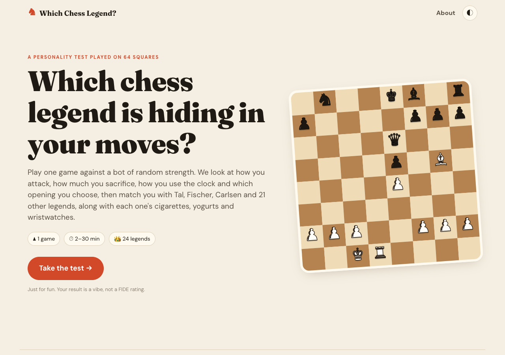
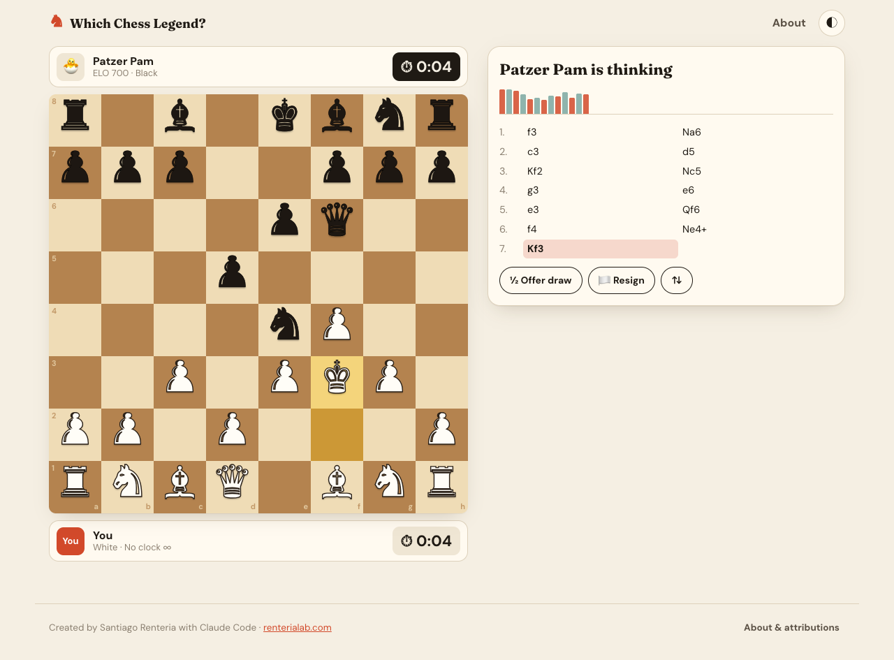
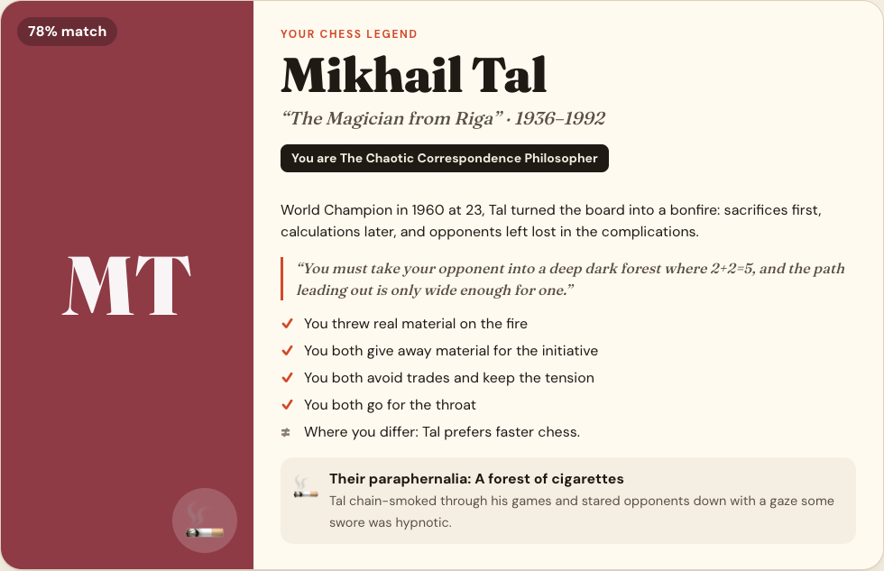
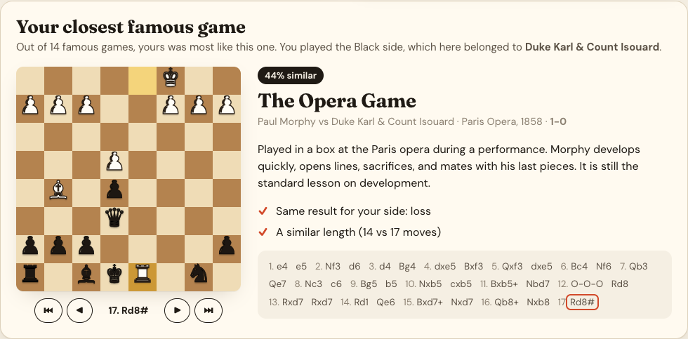
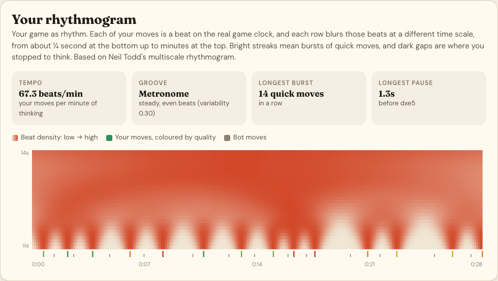
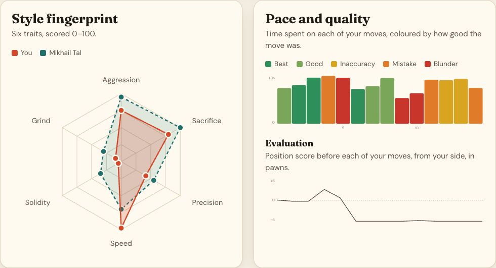
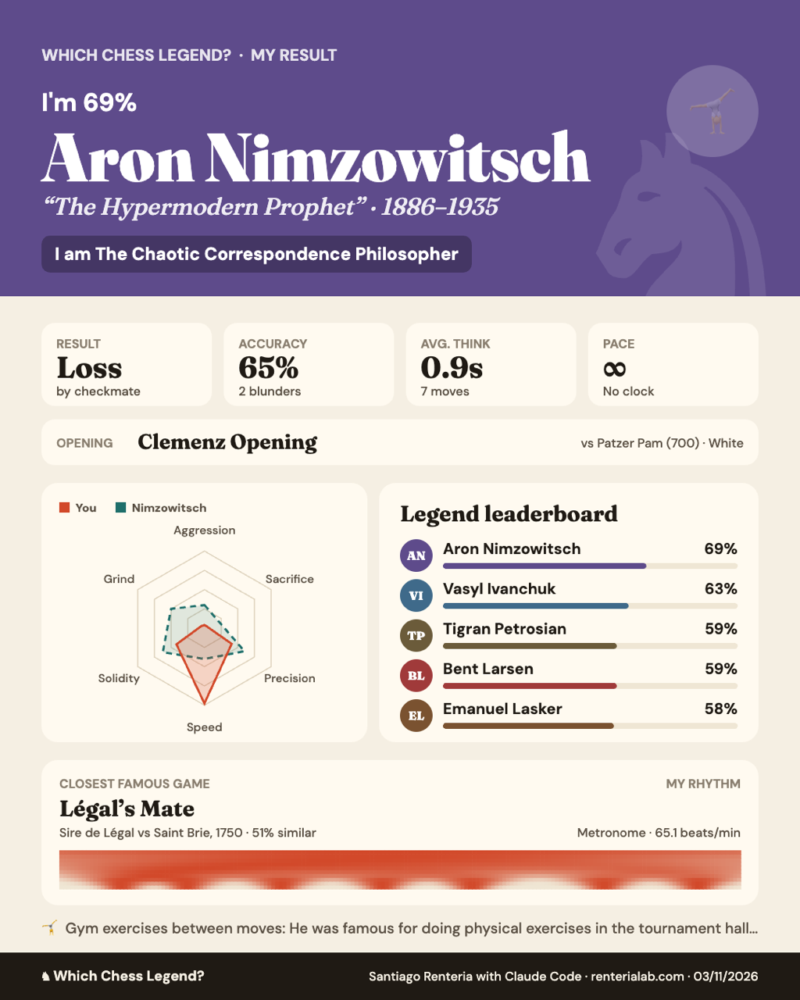
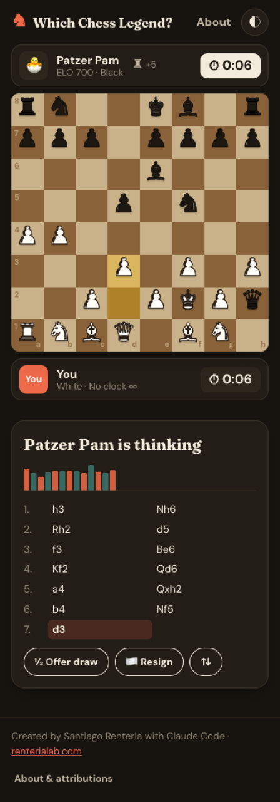

# ♞ Which Chess Legend?

**A personality test played on 64 squares.** Play one game of chess against a bot of random strength. The app then reads your style from your moves and your clock and tells you which famous player you are most like, which famous game yours resembles, and what your game's *rhythm* looked like.

It isn't meant to be serious. It's an experiment in finding links between **character, game pace, narrative and chess paraphernalia**: Tal's cigarettes, Karpov's yogurt, Kasparov's wristwatch, Alekhine's cat.

### ▶ [Play it now: hermes2507.github.io/which-chess-legend](https://hermes2507.github.io/which-chess-legend/)

> Created by **Santiago Renteria** with [Claude Code](https://claude.com/claude-code) · [www.renterialab.com](https://www.renterialab.com)



---

## Features

| | |
|---|---|
| 🎲 **Random-strength opponent** | Each opponent gets a random ELO from 400 to 2600 and a matching persona (from *Sir Hangs-a-Lot* to *Grandmaster Gizmo*). You can re-roll it or pick the ELO with a slider. |
| ⏱ **Five paces** | Bullet 1+0, Blitz 3+2, Rapid 10+0, Classical 30+0, or no clock. The pace you choose counts toward your profile. |
| ♟ **Full chess** | Click or drag to move, with legal-move hints, promotion picker, clocks with increment, captured material, draw offers, resignation, board flip, and a bot that talks a little trash. |
| 👑 **24 legends** | Ranked by how closely they match your style: Tal, Fischer, Kasparov, Carlsen, Capablanca, Karpov, Petrosian, Morphy, Nakamura, Polgár, Botvinnik, Kramnik, Anand, Nimzowitsch, Lasker, Alekhine, Larsen, Steinitz, Ivanchuk, Bronstein, Caruana, Spassky, Hou Yifan and Firouzja. |
| 📜 **Closest famous game** | Your game is matched against 14 historical games, from Légal's Mate (1750) to the Double Bongcloud (2021), with a board to replay the match. |
| 🎼 **Rhythmogram** | A multiscale picture of your move timing, after Neil Todd's rhythmogram, plus tempo, groove, longest burst and longest pause. |
| 📊 **Game review** | Engine-based accuracy, move-quality counts, a style radar, a think-time chart and an evaluation curve. |
| 🖼 **Shareable result card** | A 1080×1350 PNG summary to save or post, plus a PGN download of the game. |
| 🌗 **Light and dark themes** | The layout works on phones as well as desktop. |
| 🔒 **100% client-side** | No backend, no tracking, and nothing leaves the browser. |

## Screenshots

| Playing | Your legend |
|---|---|
|  |  |

| Closest famous game | Rhythmogram |
|---|---|
|  |  |

| Style charts | Shareable PNG card | Mobile, dark mode |
|---|---|---|
|  |  |  |

## Quick start

The easiest way is to **[play it online](https://hermes2507.github.io/which-chess-legend/)** (GitHub Pages). To run it yourself: it's a static site with no build step and no dependencies to install.

```bash
git clone https://github.com/hermes2507/which-chess-legend.git
cd which-chess-legend
python3 -m http.server 8000
# open http://localhost:8000
```

You can also just double-click `index.html`. Everything uses classic `<script>` tags, so it runs from `file://` too.

**Hosting:** upload the folder to any static host (GitHub Pages, Netlify, Vercel, S3 and so on).

**Offline:** fonts and chess.js come from CDNs. If cdnjs can't be reached, chess.js falls back to `vendor/chess.min.js`, and the fonts fall back to system fonts.

## Project structure

```
index.html            All screens (intro, setup, game, analysis, results, about)
css/style.css         Design tokens, light/dark themes, responsive layout
js/engine.js          Chess engine: 0x88 move generator, alpha-beta search, quiescence
js/analysis.js        Game review, style profile, legend matching, opening book, closest game
js/players.js         The 24 legends: style vectors, bios, quotes, paraphernalia, folklore tags
js/games.js           The 14 famous games used by the "closest game" feature
js/app.js             UI: board, clocks, bot, game flow, charts, rhythmogram, PNG card, PGN
vendor/chess.min.js   chess.js 0.10.3 (offline fallback) + its license
docs/                 Documentation and screenshots
```

## Documentation

- **[How it works](docs/HOW_IT_WORKS.md)** covers the engine, ELO levels, move review, the 15 style traits, legend matching, closest-game scoring, the rhythmogram and the result card.
- **[Extending](docs/EXTENDING.md)** covers adding legends, famous games, openings, bot personas or time controls, and how to test changes.

## Credits and attributions

- Concept inspired by the personality tests at [knowsoda.com/tests](https://knowsoda.com/tests).
- Move rules and notation: [chess.js](https://github.com/jhlywa/chess.js) 0.10.3 by Jeff Hlywa, BSD 2-Clause (see [`vendor/chess.js.LICENSE`](vendor/chess.js.LICENSE)).
- Engine piece-square tables come from Tomasz Michniewski's [Simplified Evaluation Function](https://www.chessprogramming.org/Simplified_Evaluation_Function).
- The move-accuracy formula is adapted from the public method used by [Lichess](https://lichess.org/page/accuracy).
- The rhythmogram is based on Neil P. M. Todd's multiscale rhythmogram model of rhythm perception (1994).
- Fonts: Fraunces, DM Sans and Noto Sans Symbols 2 via Google Fonts (SIL Open Font License). The pieces are Unicode chess symbols.
- The famous games are historical, public-domain game scores. The anecdotes are widely retold chess history and folklore, and some are more legend than fact.
- Players are named for educational and entertainment purposes only. None of them is affiliated with this project or has endorsed it.

See [THIRD_PARTY_NOTICES.md](THIRD_PARTY_NOTICES.md) for details.

---

*Made by Santiago Renteria with Claude Code · [renterialab.com](https://www.renterialab.com)*
